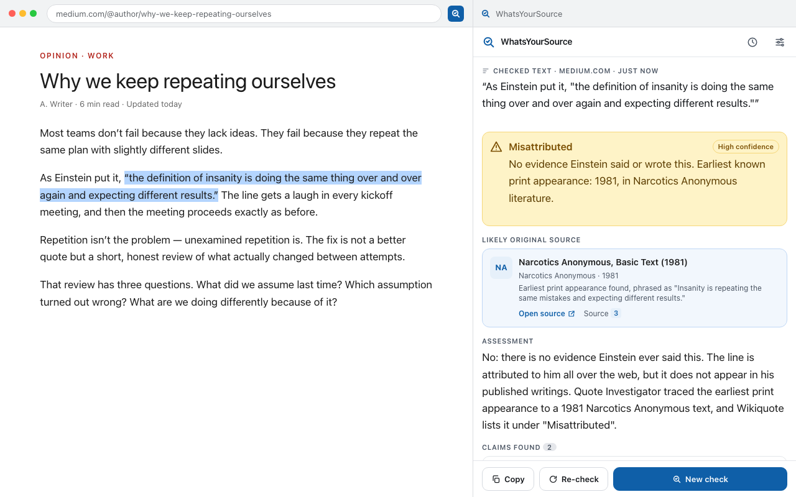
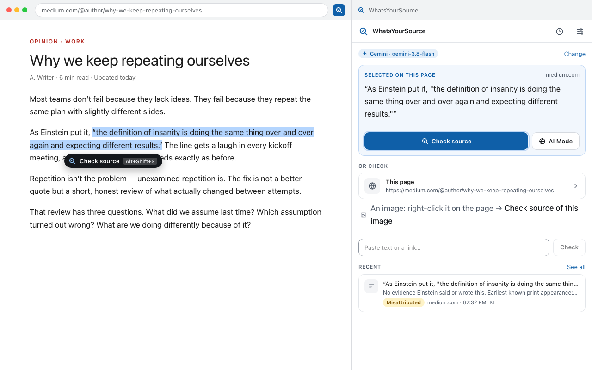
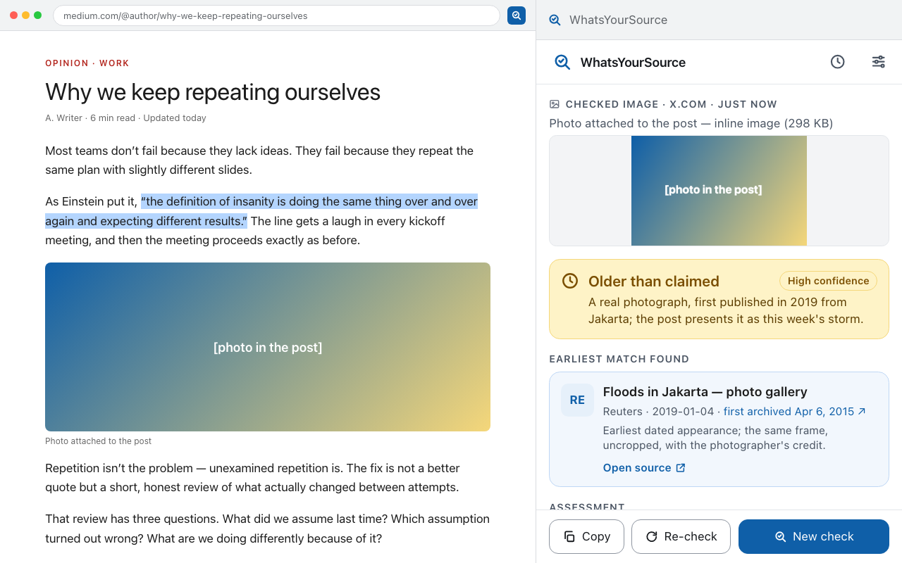
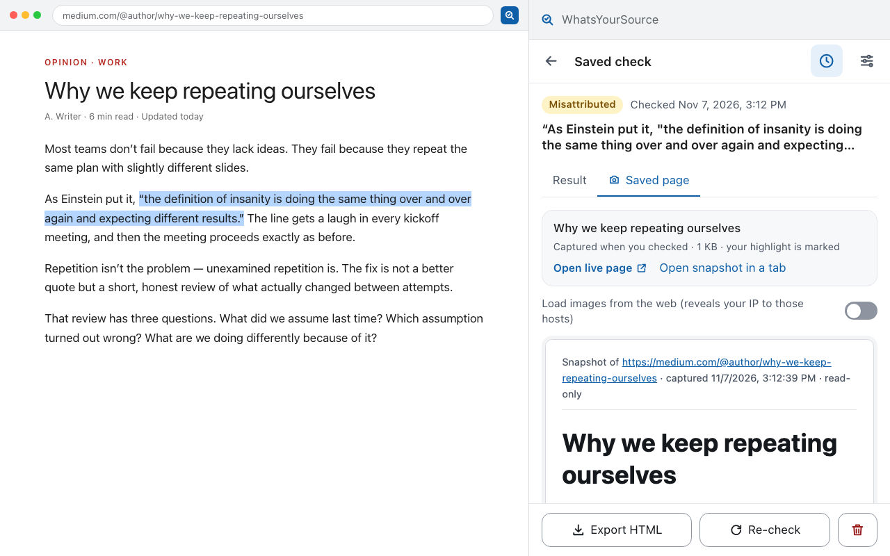
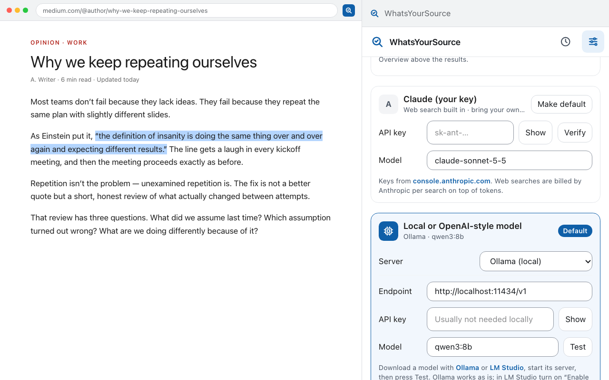
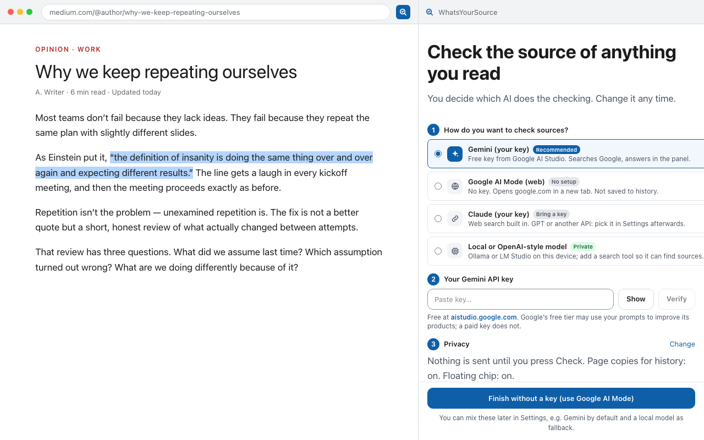
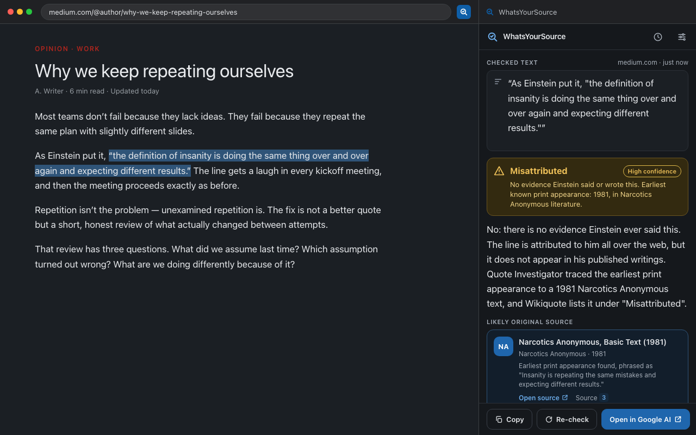
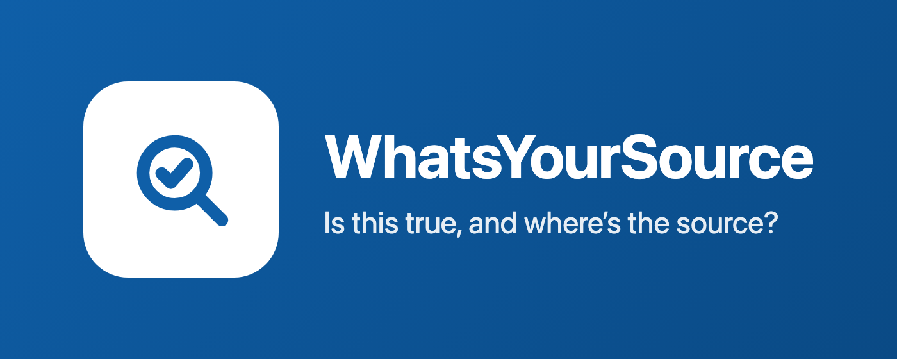

# WhatsYourSource

Browser extension (Chrome + Firefox, Manifest V3) that answers **"is this true, and where can I find the source?"** for highlighted text, images and posts — with the AI of your choice.

- **Google AI (Gemini) with your own free key** — Google Search grounding, answers and sources inside the side panel. Default.
- **Google AI Mode on the web** — no key, no setup: hands your selection to google.com in a new tab.
- **Your own frontier model** — Claude, GPT or any OpenAI-compatible API key.
- **A local model on your device** — Ollama / LM Studio (e.g. Qwen), paired with a search tool so it can find sources.

Beside the AI, every check can also show **published fact-checks** (PolitiFact, Snopes, AFP, Full Fact and others via Google's Fact Check Tools index, free key), **Wayback Machine dates** for the page and the original source, and **outlet reputation** from Wikipedia's perennial-sources list (shipped offline). Type `wys <text or link>` in the address bar to check without leaving the keyboard.

Every in-panel check is kept in a local history with a saved copy of the page it came from. Nothing leaves the browser until you press **Check**.

**What you can check:** highlighted text (floating chip, right-click, or `Alt+Shift+S`), an image (right-click → *Check source of this image*; EXIF, Content Credentials and a perceptual hash are read on your device first), a social post (right-click anywhere in it → *Check source of this post*), or the whole page.

## Screenshots

| | |
|---|---|
|  |  |
| *A result: the verdict first, then the likely original source, the assessment, the claims and the sources that were read.* | *Highlight text and the "Check source" chip appears; or press Alt+Shift+S, or right-click.* |
|  |  |
| *An image check: metadata read on your device, then the earliest appearance online.* | *Every check is saved locally with a copy of the page as it was.* |
|  |  |
| *Settings: Gemini with your key, Google AI Mode with no key, Claude, or a local model with a search tool.* | *First run: pick how to check sources; a free Gemini key or no key at all.* |
|  |  |
| *Dark mode.* | |

See [PLAN.md](PLAN.md) for the architecture, milestones and the UI mockups; [docs/PRIVACY.md](docs/PRIVACY.md) and [docs/PERMISSIONS.md](docs/PERMISSIONS.md) for what is sent where and why each permission exists.

## Install

Until the store listings are live, install from the [latest GitHub release](https://github.com/AES256Afro/WhatsYourSource/releases/latest):

- **Chrome, Edge, Brave:** download `whatsyoursource-<version>-chrome.zip`, unzip it, open `chrome://extensions` (or `edge://extensions`), turn on **Developer mode**, press **Load unpacked** and pick the unzipped folder. Updates: download the new zip and load it over the old folder, or press the reload icon on the card.
- **Firefox:** download `whatsyoursource-<version>-firefox.zip`, open `about:debugging#/runtime/this-firefox`, press **Load Temporary Add-on…** and pick the zip. A temporary add-on is removed when Firefox restarts; the Firefox Add-ons build, once reviewed, installs permanently.

Then open the side panel from the toolbar icon, pick how to check sources (a free Gemini key, Google AI Mode with no key, Claude, or a local model), highlight some text and press **Check source**.

## Privacy

Nothing leaves your browser until you press Check, and then only what you asked about goes to the one provider you configured, with your own key. No accounts, no servers of our own, no analytics. The full policy, including exactly what each provider and lookup receives, is at:

**https://github.com/AES256Afro/WhatsYourSource/blob/main/docs/PRIVACY.md**

(This is the privacy policy URL given to the Chrome Web Store, Firefox Add-ons and Edge Add-ons listings.) Permission-by-permission reasons are in [docs/PERMISSIONS.md](docs/PERMISSIONS.md).

## Development

```bash
npm install
npm run dev            # Chrome, with hot reload
npm run dev:firefox    # Firefox
npm run build:all      # .output/chrome-mv3 and .output/firefox-mv3
npm test               # unit tests (vitest)
npm run test:e2e       # loads .output/chrome-mv3 into Chromium/Edge with Playwright and runs a mocked check end to end
npm run preview        # side panel + popup in a plain browser tab against a fake browser API
                       # (?scenario=fresh|home|popup|local|image) — handy for UI work without reloading the extension
npm run lint           # ESLint (type-aware) · npm run format — Prettier
npm run screenshots    # store screenshots + promo tiles into store/ (needs `npm run preview` running)
```

### Releasing

```bash
npm run build:all && npm run zip && npm run zip:firefox
```

writes `.output/whatsyoursource-<version>-chrome.zip` (Chrome Web Store and Edge Add-ons), `-firefox.zip` (AMO) and `-sources.zip` (AMO source submission; build with Node 22, `npm ci`, `npm run build:firefox`). `npm run lint:firefox` runs the AMO linter; the warnings it reports are explained in `docs/STORE_LISTING.md`. Screenshots and promo tiles come from `npm run screenshots` with `npm run preview` running. The version comes from `package.json`.

See [MILESTONES.md](MILESTONES.md) for the plan to release, [docs/SWEEPS.md](docs/SWEEPS.md) for the audit ledger and [docs/STORE_LISTING.md](docs/STORE_LISTING.md) for the store copy.

On Firefox, the floating chip opens the panel in a small window (Firefox only lets the sidebar open from the context menu, the toolbar button or the shortcut); the other triggers open the real sidebar.

Load the unpacked build from `.output/chrome-mv3` (chrome://extensions → Developer mode → Load unpacked) or run `npm run dev:firefox`, which launches Firefox with the extension temporarily installed.

### Layout

```
src/entrypoints/   background (router), content (selection chip + page capture), sidepanel, popup, options
src/lib/providers/ one file per AI provider; the pipeline is provider-agnostic
src/lib/pipeline/  prompt, result schema, source merging, the streaming check runner
src/lib/history/   IndexedDB store for past checks and page snapshots
src/ui/            React side panel / popup / options
tests/unit/        vitest
```

### Local model + private search

A local model can't search by itself. The quickest private search backend is SearXNG in Docker: `docker/searxng/` has a ready `compose.yml` and a `settings.yml` with the JSON API enabled — set a `secret_key`, run `docker compose up -d` in that folder, then pick **SearXNG** with URL `http://localhost:8888` in the add-on's Local model card.

### Settings and keys

Keys live in `browser.storage.local` on your device. They are never synced and are only ever sent to the provider you picked. The Gemini free tier may use prompts to improve Google's products; a paid key does not.
